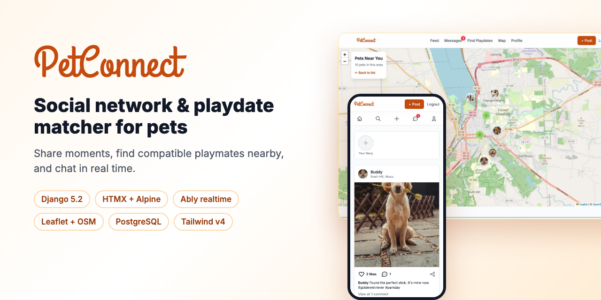
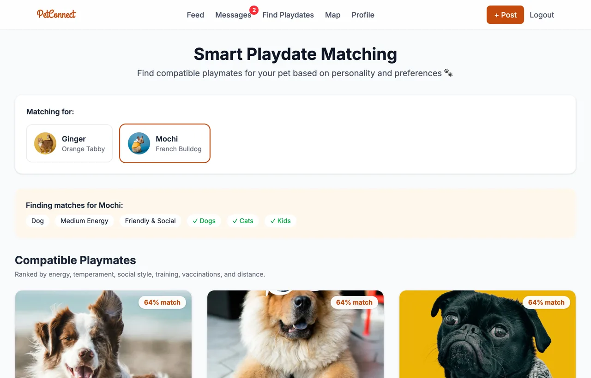
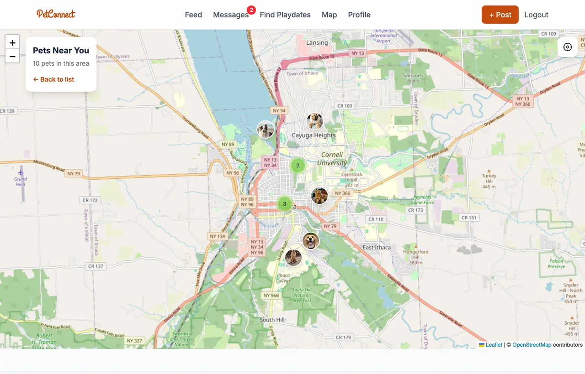
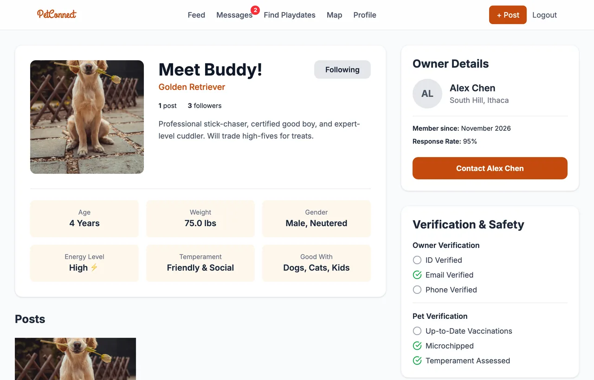
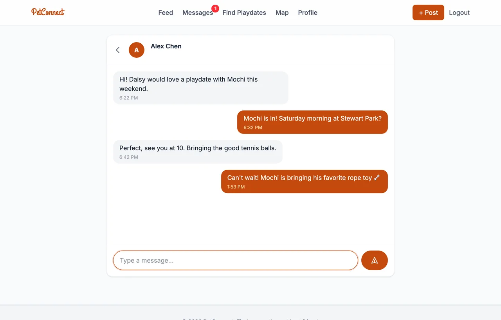
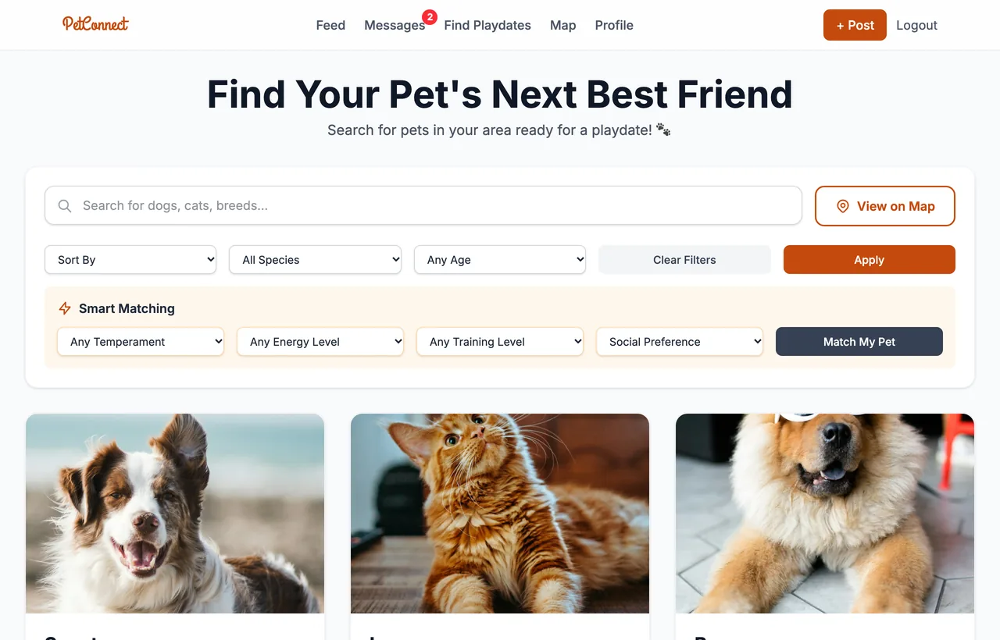
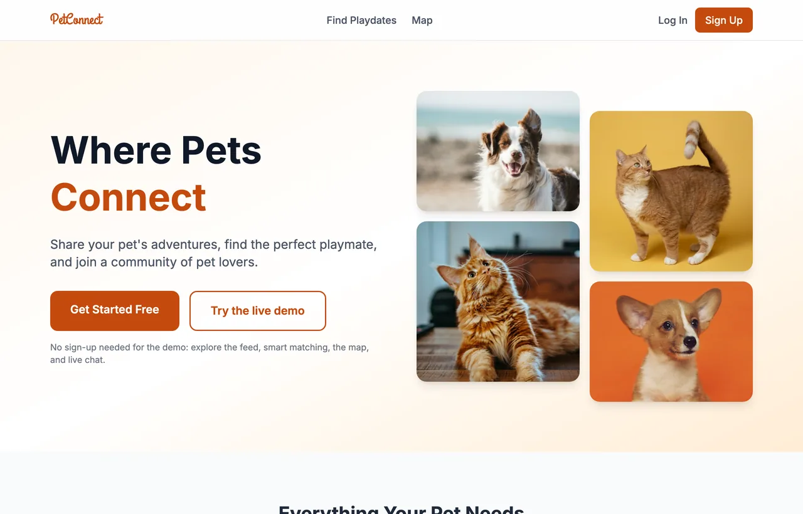
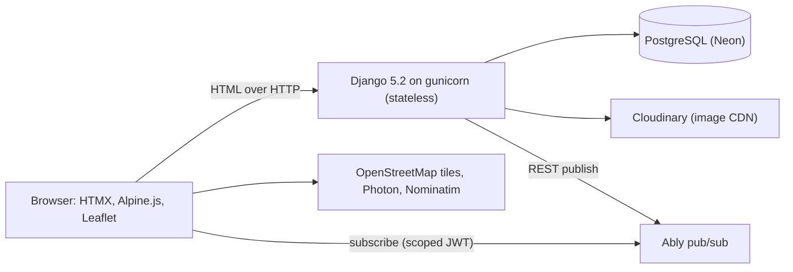

<div align="center">

# PetConnect 🐾

**A social network and playdate matcher for pets.** Share your pet's moments, find compatible playmates nearby, and chat with other owners in real time.

[](https://petconnect-2gip.onrender.com)
[](https://github.com/sniper7jd/purrfect/actions/workflows/ci.yml)


[](LICENSE)

**[Open the live demo](https://petconnect-2gip.onrender.com)**, then click **Try the live demo**. No sign-up is needed.



</div>

## Features

| | |
|---|---|
| **Feed and stories** | Instagram-style photo posts, 24-hour stories, likes, comments, and follows. Infinite scroll with HTMX. |
| **Smart playdate matching** | Ranks compatible playmates with a weighted score (energy, temperament, social style, training, vaccinations, distance), computed in a single SQL query. |
| **Playdate map** | Leaflet + OpenStreetMap with clustered pet markers. Only pets inside the visible area are loaded as you pan. |
| **Real-time chat** | Ably pub/sub with typing indicators and read receipts. Falls back to polling automatically. |
| **Location search** | Address autocomplete (Photon) and "use my location" (Nominatim). No Google API key needed. |
| **Rich pet profiles** | Personality, compatibility, health checks, reviews, and an owner card. |
| **Installable PWA** | Web manifest, app icons, and an offline page. |

## Screenshots

| Smart matching | Playdate map |
|---|---|
|  |  |
| **Pet profile** | **Real-time chat** |
|  |  |
| **Discover** | **Landing** |
|  |  |

## Architecture



**Why this shape?** Django stays a plain, stateless WSGI app with no long-lived connections and no in-memory state. That means:

- it runs on any free host that scales to zero, and it wakes in seconds;
- real-time delivery is handled by Ably, which is built for it;
- the server authorizes every browser with a short-lived JWT scoped to one conversation. The message channel is subscribe-only, so clients can't forge messages. Typing indicators go over a separate channel that clients can publish to;
- if Ably isn't configured (local dev, CI) or the connection drops, chat falls back to polling the same JSON endpoint.

**Performance notes**

- List pages count likes, comments, followers, and unread messages with correlated subqueries instead of per-row queries. The feed renders in a constant 9 queries however many posts it shows, and tests enforce this.
- Indexes cover feed, story, chat, discover, and geo lookups.
- The CSS is compiled with Tailwind v4: 7 KB gzipped and served with immutable caching by WhiteNoise. Before, the Tailwind Play CDN ran a roughly 300 KB compiler in every visitor's browser.
- Images are served through Cloudinary in WebP or AVIF and resized per use (a 96 px avatar is not a 1080 px photo). They lazy-load below the fold.

## Tech stack

**Backend:** Django 5.2 LTS, PostgreSQL (Neon), gunicorn, WhiteNoise, Cloudinary, Ably, Sentry (optional)
**Frontend:** server-rendered templates, HTMX 2, Alpine.js 3, Tailwind CSS 4, Leaflet 1.9 + markercluster
**Tooling:** uv, ruff, pytest-django, GitHub Actions (lint, tests on Postgres, Docker build), Docker

## Run it locally

You'll need Python 3.12 with [uv](https://docs.astral.sh/uv/) and Node 20+ (Node is only used to compile the CSS).

```bash
git clone https://github.com/sniper7jd/purrfect.git && cd purrfect
uv sync                    # Python deps into .venv
npm install && npm run css:build
cp .env.example .env       # DEBUG=True and SQLite by default; no accounts needed

cd petconnect
uv run python manage.py migrate
uv run python manage.py seed_data   # demo users, pets, posts, and chats
uv run python manage.py runserver
```

Open http://localhost:8000 and click **Try the live demo**. To rebuild CSS automatically while you edit templates, run `npm run css:watch`.

Or run everything with Docker and Postgres:

```bash
docker compose up --build
```

### Tests and linting

```bash
uv run pytest            # ~65 tests: views, query counts, matching, chat auth, storage
uv run ruff check . && uv run ruff format --check .
```

## Deploy for free

Every service below has a free tier that doesn't expire. The database and uploads live outside the web host, so they persist across deploys and restarts.

| Piece | Service | Setting |
|---|---|---|
| Web app | [Render](https://render.com) free web service (Docker) | health check `/healthz/`, region Ohio (next to Neon `us-east-2`) |
| Database | [Neon](https://neon.tech) | `DATABASE_URL` (use the direct, non-pooled connection string) |
| Images | [Cloudinary](https://cloudinary.com) | `CLOUDINARY_URL` |
| Real-time | [Ably](https://ably.com) | `ABLY_API_KEY` (a key with publish and subscribe) |
| Keep-awake (optional) | [UptimeRobot](https://uptimerobot.com) | HTTP monitor on `/healthz/` every 5 minutes |

1. Create the Neon database, the Cloudinary account, and the Ably app, then copy their connection strings or keys.
2. On Render, choose **New**, then **Blueprint**, and select this repo. [render.yaml](render.yaml) creates a free Docker web service and generates `SECRET_KEY`. You can also create a **Web Service** by hand with the **Docker** runtime and the same settings.
3. Fill in the environment variables Render asks for:

   ```
   DATABASE_URL=<Neon connection string>
   CLOUDINARY_URL=cloudinary://<api_key>:<api_secret>@<cloud_name>
   ABLY_API_KEY=<Ably key>
   ```

   `ALLOWED_HOSTS=.onrender.com` and `CSRF_TRUSTED_ORIGINS=https://*.onrender.com` are already set in the blueprint.

4. Deploy. On start, the container runs migrations, seeds the demo data (idempotent), and starts gunicorn on Render's `$PORT`. You can turn those steps off with `RUN_MIGRATIONS=0` or `SEED_DEMO_DATA=0`.

Render's free services sleep after 15 minutes without traffic and take about 30 to 50 seconds to wake. One service running around the clock fits inside Render's 750 free instance-hours per month, so an UptimeRobot ping on `/healthz/` keeps the demo instant. That endpoint doesn't touch the database, so Neon can still scale to zero.

The same image runs anywhere that runs containers, such as Google Cloud Run or Fly.io. Set the same environment variables.

## Project evolution

| Version | When | What changed |
|---|---|---|
| [**v1, "Purrfect Match"**](https://github.com/sniper7jd/purrfect/tree/v1-flask) | Spring 2025 | Flask + SQLAlchemy team project: pet profiles, search, messaging, events, Google Maps. |
| [**v2, PetConnect**](https://github.com/sniper7jd/purrfect/tree/v2-django) | Nov 2025 | Rewritten in Django + PostgreSQL with an Instagram-style UI, Channels WebSockets, and Render hosting. |
| **v2.1** | Nov 2026 | Stateless Django 5.2 with HTMX/Alpine, Ably instead of Channels, OpenStreetMap instead of Google Maps, query and asset performance work, demo login, PWA, tests and CI, free hosting with persistent data. |

## What I learned

- **Pick the hosting model before the real-time model.** WebSockets on a single in-memory Channels layer worked locally but fought every free host. Moving pub/sub to a managed service made the app simpler *and* more reliable.
- **Count with subqueries, not properties.** `post.likes.count()` in a template is an N+1 query waiting to happen. Correlated subqueries keep page cost flat, and `django_assert_num_queries` tests keep it that way.
- **Respect free APIs' usage policies.** Nominatim forbids autocomplete, so Photon handles typeahead and Nominatim only runs once per button press.
- **Treat secrets as compromised once committed.** v1 accidentally committed an `.env`. The keys were rotated, and the history was rewritten with `git filter-repo`.

## Roadmap

- Web Push notifications for new messages
- Social login (GitHub/Google) and passkeys via django-allauth
- PostGIS distance search ("pets within 5 km")
- Playdate scheduling with calendar invites

## License

[MIT](LICENSE) © Jagrit Dhingra. Demo photos are from [Unsplash](https://unsplash.com/license).
